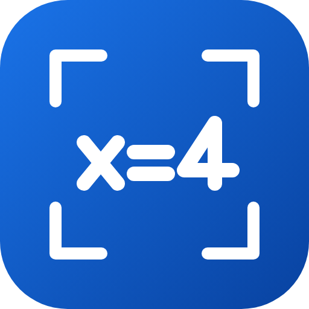
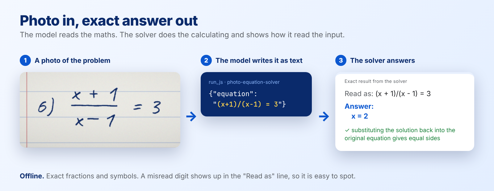
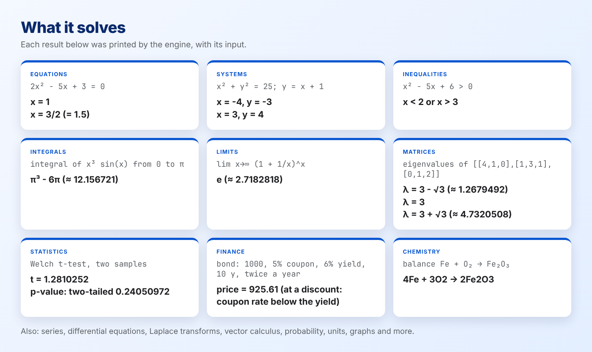
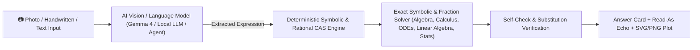

<p align="center">
  
</p>

<h1 align="center">Photo Equation Solver</h1>

<p align="center">
  <b>Exact, offline maths for AI models.</b><br>
  The model reads the problem. The solver calculates.
</p>

<p align="center">
  <a href="https://github.com/callmesobhan/photo-equation-solver/actions/workflows/ci.yml"></a>
  
  
  
  <a href="LICENSING.md"></a>
</p>

<p align="center">
  <a href="#editions">Editions</a> &middot;
  <a href="photo-equation-solver/README.md">Full docs</a> &middot;
  <a href="mcp-server">MCP server and command line</a> &middot;
  <a href="https://www.agensi.io/skills/photo-equation-solver-exact-maths-for-your-agent">Agensi listing</a> &middot;
  <a href="LICENSING.md">Get a licence</a>
</p>

<p align="center">
  
</p>

> **Licence.** Free to read, and to try on your own devices for 30 days. Anything beyond that (ongoing use, teaching,
> client work, business use) needs a paid licence: see [`LICENSING.md`](LICENSING.md) and [`LICENSE`](LICENSE).

The model *reads* the maths, from a photo or from text; a self-contained solver does all the *calculating* with exact
fractions and symbolic expressions, and echoes how the input was read so a misread digit is easy to spot. No internet,
no cloud, no API key.

It started as a skill for **Gemma 4 E4B** on a phone (Google AI Edge Gallery) and now comes in three editions
(see [Editions](#editions)): one for phones, one for local models, one for capable agents.

<p align="center">
  
</p>

It covers equations, systems and inequalities, calculus (integrals, derivatives, limits,
series, tangent lines, curve study, areas and volumes), several-variable calculus, linear
programming, differential equations (first order of the usual textbook types, linear of any
order, Euler equations, systems) and Laplace transforms, parametric / polar / vector calculus,
numerical methods (Euler, Runge-Kutta, Simpson, bisection, interpolation), matrices, complex numbers, number
theory and counting, logic and graph algorithms, recurrences, statistics and probability, geometry (triangles, conic sections), unit
conversion, finance, chemistry (molar mass, balancing equations), physics formulas and graphs.

| | |
|---|---|
| Skill folder | [`photo-equation-solver/`](photo-equation-solver) - `SKILL.md`, `scripts/index.html`, `README.md` |
| Full docs (what it can do, install, notation, limits) | [`photo-equation-solver/README.md`](photo-equation-solver/README.md) |
| MCP server and command line tool (for agents and editors) | [`mcp-server/`](mcp-server) |
| Skill packages for local models and for agents | [`packages/local`](packages/local), [`packages/agent`](packages/agent) |
| Library for embedding the solver in your own program (structured results, TypeScript types) | [`mcp-server/`](mcp-server#as-a-library) |
| Teacher kit: worksheets with answer keys, and a student-working checker | [`teacher-kit/`](teacher-kit) |
| Source, build and tests | [`dev/`](dev) |
| Accuracy report, generated from a full run of the test suite | [`docs/ACCURACY.md`](docs/ACCURACY.md) |
| Agensi listing (text-only skill for agents) | [Photo Equation Solver: exact maths for your agent](https://www.agensi.io/skills/photo-equation-solver-exact-maths-for-your-agent) |
| Licence | [`LICENSE`](LICENSE): proprietary, not free to use |

## Architecture



## Editions

One exact solver, packaged for three kinds of model:

| Edition | For | Instructions | How you get it |
|---|---|---|---|
| **Pocket** | Gemma 4 E4B on a phone, in Google AI Edge Gallery | `photo-equation-solver/SKILL.md`, under 2 KB, with a one-page JavaScript solver | import the folder |
| **Local** | mid-size and large local models (for example Gemma 4 26B / 31B, Qwen, Llama) in an agent harness | [`packages/local`](packages/local): strict rules, a command list, examples, plus the CLI and MCP server | `node dev/package-skills.mjs` writes `dist/photo-equation-solver-local.zip` |
| **Agent** | Claude Code, Cursor, Copilot, Gemini CLI, Codex CLI, Antigravity and other capable agents | [`packages/agent`](packages/agent): a short workflow, a tested cheat sheet, plus the CLI and MCP server | `node dev/package-skills.mjs` writes `dist/photo-equation-solver-agent.zip` |

The Local and Agent packages run the engine through `node scripts/bin/cli.js` or the MCP server (`mcp-server/`).

To hand the Agent edition to someone who uses Claude Code, `node dev/package-bundle.mjs` builds `photo-equation-solver-for-claude-code.zip`: they give it to Claude Code and say "install this" (it holds `INSTALL.md` and a small installer).

**For teachers**, [`teacher-kit/`](teacher-kit) makes printable worksheets and answer keys from a seed (same seed, same sheet; every answer is computed by the solver and agrees with an independent calculation made when the problem was built) and checks a student's working line by line, naming the first wrong step. `node dev/package-teacher.mjs` builds its zip. Using it in teaching needs a licence: see [`LICENSING.md`](LICENSING.md).

For marketplaces that deliver text files only, [`packages/agensi`](packages/agensi) is the same instructions as a text-only skill: the engine is installed separately by the user (`reference/install.md`). `node dev/package-agensi.mjs` builds its zip. This is the skill listed on [Agensi](https://www.agensi.io/skills/photo-equation-solver-exact-maths-for-your-agent); the listing is free, and the engine it uses stays under this repository's [licence](#licence).

## Licence

This is **not** free software. The source is public so that you can read it and try it for up to 30 days; using it
beyond that, or sharing it, needs a paid licence. See [`LICENSE`](LICENSE) for the exact terms, and [`LICENSING.md`](LICENSING.md) for how to ask for a licence. The install steps
below are for evaluation or for licensed use.

## Install in AI Edge Gallery

For fully offline use, install the skill so the app copies it into its own storage
(**Import local skill**, or paste it into the in-app skill editor). Skills added with
**Load skill from URL** only remember the URL and re-download `scripts/index.html` on every run.

To use the URL route, make this repository public, enable GitHub Pages (deploy from the
`main` branch, root), and enter `https://callmesobhan.github.io/photo-equation-solver/photo-equation-solver`
in *Skills → (+) → Load skill from URL*. Check that `<that url>/SKILL.md` shows plain text.
The empty `.nojekyll` file in this repo keeps Pages from rewriting the Markdown.

## Develop

```bash
cd dev
./run-all.sh      # rebuilds photo-equation-solver/scripts/index.html and runs every test
```

Edit `dev/src/*.js`, never the generated `index.html`. See [`dev/README.md`](dev/README.md).

## Status

Tested on a desktop against independent oracles (sympy, scipy, numpy, pint, periodictable,
numpy-financial), with fuzzing, and with the page loaded in offline Chromium exactly as the
app calls it (details in the skill README). The [accuracy report](docs/ACCURACY.md) lists every battery with its counts, what each is compared with, and what the tests do not show.

Tried on an iPhone with Gemma-4-E4B-it in Google AI Edge Gallery (GPU), by importing the folder, with typed
problems and simulated handwritten photos.

The Local and Agent packages and the MCP server are covered by automated tests (a real stdio session with the
MCP server, every documented command line), but have not yet been run inside particular agent products or with
particular local models.
