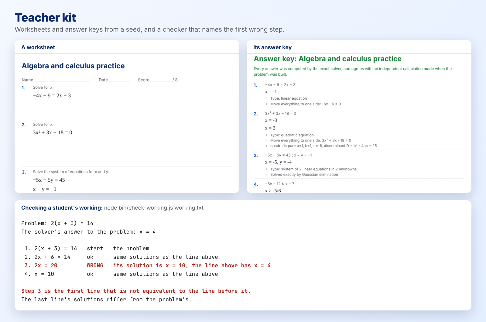

# Teacher kit: worksheets, answer keys and a working checker

Two small tools built on the exact solver in this repository:

- **`bin/worksheet.js`** makes a printable worksheet and an answer key from a seed. The same seed gives the same sheet,
  so a key can always be made again, and `--variants` gives each group its own version.
- **`bin/check-working.js`** reads a student's working, line by line, and names the first step that is wrong.



> **Licence.** Free for personal use and non-commercial academic research (with citation). Commercial use — including commercial teaching, paid grading/edtech platforms, or business use — requires a commercial licence: see [`LICENSE`](../LICENSE) and [`LICENSING.md`](../LICENSING.md).

Needs Node.js 18 or newer. No other packages, no network.

## Worksheets

```
node bin/worksheet.js --topics linear,quadratic,system --level 2 --count 12 --seed 7 --title "Algebra practice" --out sheet.html
```

Open `sheet.html` in a browser. The worksheet is the first page(s); the answer key starts on a page of its own.
To get a PDF, print it from the browser ("Save as PDF").

| Option | Meaning |
|---|---|
| `--topics a,b,c` | which kinds of problem (below); `all` for every topic. The topics take turns down the sheet |
| `--level 1\|2\|3` | difficulty (default 2) |
| `--count N` | number of problems, 1 to 60 (default 10) |
| `--seed N` | the same seed makes the same worksheet again. The default is today's date as a number |
| `--variants N` | N different worksheets from consecutive seeds, written as `sheet-A.html`, `sheet-B.html`, ... |
| `--title "text"` | the heading |
| `--format html\|md\|json` | default: taken from the `--out` file name (`.md`, `.json`), otherwise HTML. `--out -` prints to the screen |
| `--no-key` | leave out the answer key |
| `--working` | add the solver's working steps under each answer in the key |
| `--list` | show the topics |

| Topic | Level 1 | Level 2 | Level 3 |
|---|---|---|---|
| `linear` | `5x − 7 = 13` | `−2x − 1 = 3x − 11` | `7(x + 4) = 3x + 5` (fraction answers) |
| `quadratic` | whole-number roots, `a = 1` | `a ≠ 1`, sometimes a repeated root | rational roots |
| `system` | `x + y = s`, `x − y = d` | two general equations, whole-number answer | fraction answers |
| `inequality` | `ax + b < d` | `ax + b < cx + d` | same (negative coefficients flip the sign) |
| `derivative` | polynomials | `sin`, `cos`, `e^(kx)`, `ln x` | chain and product rules |
| `integral` | definite, degree 2, from 0 | degree 3, any limits | wider limits, fraction answers |
| `fractions` | `a/b ± c/d` | three terms | `(a/b + c/d) × e/f` or `÷` |
| `determinant` | 2 × 2 | 3 × 3, small entries | 3 × 3 |

### Why the answer key can be trusted

Every problem is built from numbers the generator chooses, so it knows its own answer from the way it built the
problem (roots chosen first, then the equation made from them). For each problem the **solver** is asked for the
answer, and the problem is kept only if the two agree. If they ever disagree, that problem is dropped and another is
drawn; if that keeps happening, nothing is written. The test suite
([`dev/tests/teacher-test.mjs`](../dev/tests/teacher-test.mjs)) also checks 600 generated problems a second way,
by substituting roots back into the equation, comparing derivatives with a finite difference and integrals with
numerical quadrature.

What this does **not** cover: the wording of a problem, whether a problem is a good one for your class, or topics
outside the list above. The key shows the solver's own formatting (for example `x = 3/2 (= 1.5)`).

## Checking a student's working

Put the problem on the first line and one step on each following line:

```
2(x + 3) = 14
2x + 6 = 14
2x = 20
x = 10
```

```
node bin/check-working.js working.txt
```

```
Problem: 2(x + 3) = 14
The solver's answer to the problem: x = 4

 1. 2(x + 3) = 14   start   the problem
 2. 2x + 6 = 14     ok      same solutions as the line above
 3. 2x = 20         WRONG   its solution is x = 10, the line above has x = 4
 4. x = 10          ok      same solutions as the line above

Step 3 is the first line that is not equivalent to the line before it.
The last line's solutions differ from the problem's.
```

You can also give the lines on the command line:
`node bin/check-working.js --problem "2(x+3) = 14" --step "2x + 6 = 14" --step "2x = 20"`, or pipe them in with `-`.
`--json` prints the same report as JSON.

### OCR-Ambiguity Branching & Handwritten Equivalence (`--ocr-tolerant` / `--ambiguous`)

When a vision model transcribes handwritten equations or student working from a photo, visual confusions (`l↔1`, `O↔0`, `S↔5`, `z↔2`, `b↔6`, `g↔9`, `×↔x`, or fraction-bar grouping like `x + 1/2 = 3` vs `(x + 1)/2 = 3`) cause single-pass solvers to silently solve the wrong problem or falsely accuse students of math mistakes:

- **`--ocr-tolerant`** (`checkWorking(api, text, { ocrTolerant: true })`): before marking a step `WRONG` or `unknown`, checks whether a single visual-OCR or fraction-grouping slip (never `+ ↔ -` sign flips, which remain genuine math errors) restores exact mathematical equivalence with the previous step — reporting it as `ocr?` (`ocr_likely`) without cascading false errors onto subsequent steps.
- **`--ambiguous "<expr>"`** (`solveAmbiguous(api, input)` in `lib/ambiguity.js`): solves every plausible visual/grouping reading — including explicit VLM uncertainty brackets like `2x + [5|S] = 14` or `[x+1/2 | (x+1)/2] = 3` — checks answer consensus, and auto-generates a one-line disambiguating question whenever branches yield different exact answers.

How a line is judged:

| The line is | It is right when | Reported as |
|---|---|---|
| an equation or inequality in one unknown | it has **the same solutions** as the line above it | `ok`; a different solution set is `WRONG` (and the report says whether a solution was lost) |
| an expression (no `=`, `<`, `>`) | it **equals** the line above | `ok` or `WRONG`. Equality is first tried by simplifying the difference to 0, and otherwise by evaluating the difference exactly at several points, including negative ones; one different value proves "not equal", agreement everywhere is reported as "equal at N test points" |

Also understood: step labels (`Step 2:`, `2.`, `⇒`), a leading `Solve:` or `Simplify:`, answers written as
`x = 2 or x = 3`, `x = 2 and x = 3` or `x = 2, x = 3`, and chains of an expression written as `= 5x` on a new line.

Things to know:

- **A step that adds a solution is `extra`, not `WRONG`.** Squaring both sides can do that legitimately; the report
  says every solution must then be checked in the original problem, and names the one that fails
  (for `√x = x − 2`: "The last line has solutions the problem does not have: x = 1").
- **A line the solver cannot compare is `unknown`**, never right or wrong: a `≠`, an equation next to an expression,
  or a line it cannot solve. Exit code 3.
- With two or more unknowns (`2x + 3y = 6` then `y = 2 − 2x/3`) steps are compared the same way, but "finished" is
  not judged.
- It judges **mathematical equivalence, not method**. A student who guesses `x = 4` and writes nothing else gets a
  correct line. It cannot read words ("add 3 to both sides"), pictures or handwriting.
- It finds the first line that is not equivalent to the line before it. Later lines that are consistent with that
  wrong line are reported `ok`: that is deliberate, so a single slip is not blamed on every later line.

Exit codes: `0` every step valid, `1` a wrong step was found, `3` no wrong step but some line could not be compared,
`2` usage error.

## As a library

```js
const { loadEngine } = require('./lib/engine.js');
const { buildWorksheet, renderHtml } = require('./lib/worksheet.js');
const { checkWorking } = require('./lib/working.js');

const api = loadEngine();                       // the solver library (../mcp-server/lib/api.js)
const sheet = await buildWorksheet(api, { topics: ['linear'], count: 5, level: 1, seed: 3 });
const report = await checkWorking(api, '2x + 6 = 14\n2x = 8\nx = 4');
```

`loadEngine()` looks for the solver next to this folder (`../mcp-server`), inside a packaged copy (`./scripts`), or at
the path in the environment variable `PES_ENGINE`.

## Tests

`node dev/tests/teacher-test.mjs` (also step 8zk of `dev/run-all.sh`) checks the generators against the solver and a
second method, the worksheets (same seed, same sheet; unique problems; escaping; formats), the working checker on
hand-written student work, and a **mutation test**: correct chains of steps must never be called wrong, and a
deliberately corrupted step must be found at exactly that step. `node dev/package-teacher.mjs` builds
`photo-equation-solver-teacher-kit.zip` (this folder plus the solver) and tests the unzipped copy.
